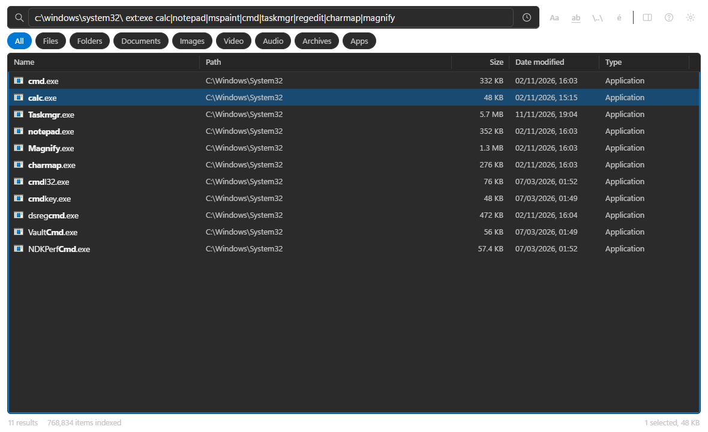

# FindIt

**Instant file search for Windows.** Type a few letters and every matching file
and folder on your PC appears as you type, in milliseconds, and stays current
as files change.

FindIt exists because File Explorer's search is slow, misses files, and cannot
combine simple filters. FindIt keeps its own compact index of file *names* (never
contents), works fully offline, and needs no administrator rights.



- [Features](#features)
- [Install](#install)
- [Searching](#searching)
- [Keyboard](#keyboard)
- [Privacy](#privacy)
- [Fast mode](#fast-mode)
- [Performance](#performance)
- [Build from source](#build-from-source)
- [How it works](#how-it-works)
- [Troubleshooting](#troubleshooting)
- [Uninstall](#uninstall)
- [Known limitations](#known-limitations)
- [Dependencies and licenses](#dependencies-and-licenses)

## Features

- Results while you type, across all local drives; removable and network drives are opt-in.
- New, renamed, moved and deleted files show up within about a second.
- A small query language: `report budget`, `jpg|png`, `!backup`, `"annual report"`,
  `*.docx`, `regex:^IMG_\d{4}`, `path:Projects\2026`, `ext:pdf;docx`, `size:>100mb`,
  `dm:last7days`, `type:image`, `folder:`, `case:`, `word:`, `diacritics:`.
- Unicode-correct: Cyrillic, Greek, CJK and emoji names match case-insensitively;
  `café`, `cafe` and a decomposed `cafe` + accent all match each other.
- Filter chips (Files, Folders, Documents, Images, Video, Audio, Archives, Apps),
  sortable/resizable/reorderable columns, matches in bold, Windows file icons.
- Open, Open with, Open containing folder, Copy, Copy path, Copy name, Rename,
  Delete (to the Recycle Bin, after confirmation), Properties.
- Preview pane for images and text, search history.
- Tray icon, global shortcut (Ctrl+Alt+Space), optional start with Windows.
- Follows the Windows light/dark theme and accent color, Mica on Windows 11,
  high-contrast mode, 100% to 300% scaling, full keyboard and screen-reader support.
- Optional **fast mode** for NTFS drives (indexes a million files in seconds).

## Install

FindIt runs on **Windows 10 22H2 or Windows 11, x64**. Download from the
[Releases page](https://github.com/yasen-18/FindIt/releases):

| File | Use it if |
|------|-----------|
| `FindIt-Setup-x64.exe` | You want FindIt installed with a Start menu entry. Installs for your account only; no administrator rights needed. |
| `FindIt-portable-x64.zip` | You want to run it from a folder or USB stick. Unzip and run `FindIt.exe`; the index is stored next to it (because of the included `portable.flag`). |
| `FindIt-portable-x64.exe` | You want just the program. Its data goes to `%LOCALAPPDATA%\FindIt`. |

Check a download with `Get-FileHash .\FindIt-Setup-x64.exe` and compare it with `SHA256SUMS.txt`.

FindIt uses Microsoft Edge WebView2 for its window. It is part of Windows 11 and
of every up-to-date Windows 10; if it is missing, the installer downloads it.

### "Windows protected your PC"

Until the release files are code-signed and have built up a download history,
Microsoft Defender SmartScreen shows this warning for any new program. Click
**More info**, check that the publisher/file name is what you expect, then click
**Run anyway**. Building from source (below) avoids the warning entirely.

### First start

A short welcome asks which drives to index and whether to use fast mode. FindIt
starts indexing right away and you can search immediately: results appear while
the index is still being built, and the status bar says so.

## Searching

Typing words finds names that contain **all** of them, in any order, ignoring
case and accents: `inv 2024` finds `Invoice_2024.pdf`. Press **F1** in the app
for this table.

| Syntax | Meaning | Example |
|--------|---------|---------|
| space | AND | `report budget` |
| `\|` | OR (binds tighter than AND) | `jpg\|png` |
| `!` | NOT | `!backup` |
| `< >` | grouping | `<report budget>\|invoice` |
| `"..."` | exact phrase | `"annual report"` |
| `*` `?` | wildcards (whole name) | `*.docx`, `IMG_????.jpg` |
| `regex:` | regular expression (quote it if it contains `\|` or spaces) | `regex:^IMG_\d{4}` |
| `path:` | match the full path; any term containing `\` does this too | `path:Projects\2026` |
| `ext:` | extensions, `;` separated | `ext:pdf;docx` |
| `size:` | size: `>` `<` `>=` `<=` `=`, ranges, units kb/mb/gb, or empty/tiny/small/medium/large/huge/gigantic | `size:>100mb`, `size:1mb..10mb` |
| `dm:` | date modified: today, yesterday, thisweek, lastweek, thismonth, lastmonth, thisyear, last*N*days, a date, or a range | `dm:2026-01-01..2026-03-31` |
| `type:` | image, video, audio, doc, archive, exe, code | `type:image` |
| `file:` `folder:` | only files / only folders | `folder: node_modules` |
| `case:` `word:` `diacritics:` | per term (`case:Readme`), or for the whole search when used alone (`case: Readme`) | `word:report` |
| `content:` | full-text search: not part of version 1 (shows an explanation) | |

Invalid searches never crash anything: the search box turns red and a short
message says what is wrong (for example a regex with an unclosed group).

## Keyboard

| Keys | Action |
|------|--------|
| Ctrl+Alt+Space | Show FindIt from anywhere (configurable) |
| Ctrl+F, Ctrl+L | Focus the search box |
| Down arrow | Move from the search box into the results |
| Enter | Open (from the search box: open the top result) |
| Ctrl+Enter | Open the containing folder with the file selected |
| Alt+Enter | Windows properties |
| Ctrl+C / Ctrl+Shift+C | Copy the file / copy its full path |
| F2 | Rename |
| Delete | Move to the Recycle Bin (asks first) |
| Shift+F10 or the Menu key | All actions |
| Ctrl+A, Shift+arrows, Ctrl+click | Select several items |
| Ctrl+1 … Ctrl+9 | Filter chips |
| Alt+C / Alt+W / Alt+P / Alt+A | Match case / whole words / full path / accents |
| Alt+V | Preview pane |
| Alt+Down | Recent searches |
| F1 | Search syntax |
| Esc | Clear the search; press again to hide the window |

## Privacy

FindIt sees the name of every file on your PC, so it is built to be trustworthy:

- **Local only.** No accounts, no telemetry, no background network traffic. The
  one network request is the **Check for updates** button in Settings, and only
  when you press it (it reads the latest release from the GitHub API). FindIt
  works the same with a firewall blocking it completely.
- **Names, not contents.** The index holds names, folders, sizes, dates and
  attributes. File contents are never read for indexing; the preview pane reads a
  file only when you select it with the pane open.
- **Private storage.** The index, settings and logs live in
  `%LOCALAPPDATA%\FindIt` (readable only by your account), or next to the exe in
  portable mode. Logs never contain file paths at the default level.
- **Cloud files stay in the cloud.** OneDrive and other online-only placeholders
  are listed by name without being downloaded; they are never opened or previewed.
- **Safe actions.** Delete always goes to the Recycle Bin after a confirmation.
  Files are opened through the Windows shell with the path as an argument, never
  by building command lines. Rename never overwrites an existing file.

## Fast mode

Standard mode walks every folder (a few minutes for a big drive) and watches for
changes. **Fast mode** reads the NTFS master file table instead, which indexes a
million files in seconds, and follows the NTFS change journal.

Reading the file table needs administrator rights, so turning fast mode on shows
a Windows UAC prompt (and does so each time FindIt starts while fast mode is on).
FindIt explains this before asking. What happens:

- A separate helper process (the same `FindIt.exe`, started with `runas`) gets the
  permission. It can only enumerate the file table, read the change journal and
  list folders. It drops every Windows privilege except read-only backup access,
  has no code that writes, deletes or runs anything, and exits when FindIt exits.
- It talks to FindIt over a named pipe that only your user account may open
  (`FILE_FLAG_FIRST_PIPE_INSTANCE`, remote clients rejected). Each side checks
  the other's process id, and every message is size-limited and validated.
- **Visibility:** names of *all* files on the drive become searchable from your
  account, including those in folders you cannot normally open (such as other
  users' profiles). File contents are never read.
- Saying **No** to the prompt is fine: FindIt keeps working in standard mode.

## Performance

Measured with the included benchmark (`cargo bench -p findit-core --bench search`)
on 1,000,000 synthetic entries, 12-thread desktop CPU, release build:

| Metric | Target | Measured |
|--------|--------|----------|
| Substring search, keystroke to results (p95) | < 50 ms | 38 ms |
| Regex search (p95) | < 200 ms | 33 ms |
| Path search (p95) | < 200 ms | 40 ms |
| Load snapshot (launch from snapshot) | < 1.5 s | 0.45 s |
| Save snapshot | < 3 s | 0.18 s |
| Snapshot size | < 150 MB | 81 MB |
| Index memory | < 300 MB | 90 MB |

The p95 includes worst cases such as a one-letter search that matches almost
everything and must sort a million results.

On a real Windows 11 system drive (about 730,000 files and folders, fast mode,
release build), measured from the window including the round trip to Rust:
typical searches take 5 to 10 ms, a one-letter search with 474,000 matches
29 ms, `*.dll` 29 ms and a regex 19 ms. A newly created file was searchable
about 0.3 s after it was written, a moved and renamed one about 0.45 s after. The benchmark exits with an error if
a target is missed. In CI it runs on GitHub's small shared runners for
information only.

The integration test `crates/findit-indexing/tests/scan_watch.rs` creates, renames,
moves and deletes real files and checks that the index catches up; on the
development machine every change was visible in well under one second.

## Build from source

Prerequisites (one time):

1. [Rust](https://rustup.rs/) (stable, with the MSVC toolchain)
2. Visual Studio 2022 Build Tools with **Desktop development with C++**
3. [Node.js](https://nodejs.org/) 20 or newer
4. (only for signing) the Windows SDK, which provides `signtool.exe`

Then, in PowerShell:

```powershell
git clone https://github.com/yasen-18/FindIt.git
cd FindIt
.\build.ps1
```

The files land in `dist-release\`. `build.ps1` runs the tests first; add
`-SkipTests` to skip them. To sign, set `FINDIT_SIGN_THUMBPRINT` (certificate in
your store) or `FINDIT_SIGN_CERT` + `FINDIT_SIGN_PASSWORD` (a .pfx file) before
running it; without them the build is simply unsigned. No packers or obfuscators
are used.

Development:

```powershell
npm ci
npx tauri dev          # app with live reload
cargo test --workspace # all tests
cargo bench -p findit-core --bench search
```

The version number lives in one place: `version` in the root `Cargo.toml`.

## How it works

```
FindIt/
  crates/
    findit-core/       index model, query parser, matcher, search engine, snapshot (no OS code)
    findit-indexing/   Windows scanners: folder walk, watcher, USN journal, helper pipe
  src-tauri/           the app: commands, engine, tray, hotkey, shell actions, helper entry
  src/                 the window: TypeScript + CSS, strings in src/locales/en.json
  build.ps1            builds every release file
```

- **Index layout.** All names live in one contiguous UTF-8 string, plus a second
  string with every name pre-folded (lowercase, accents removed). Each entry is a
  40-byte record with offsets into those strings, its parent id, size, date and
  flags. Full paths are never stored; they are rebuilt from parent ids on demand.
- **Search.** The query is compiled into a predicate tree. The entry array is split
  into 16K-entry chunks that are scanned on all CPU cores with SIMD substring
  search (`memchr`). A newer keystroke cancels an older search within one chunk.
  Sorted views and folder paths are cached until the index changes.
- **Regex.** Uses the `regex` crate, whose matching time is linear in the input,
  so no pattern can hang the app; patterns are size-limited and a regex search
  that runs longer than 3 seconds returns partial results with a note.
- **Hard links.** NTFS lets one file have names in several folders (most of
  `C:\Windows\System32` is hard-linked from `WinSxS`). The file table reports one
  name per file, so fast mode also checks every folder listing and adds the other
  names; deleting the file removes all of them. Standard mode sees every name
  directly.
- **Updates.** Standard mode uses `ReadDirectoryChangesW` on each drive (a 1 MB
  buffer, re-armed immediately; on overflow the drive is rescanned and merged).
  Changes are batched for 100 ms and the window refreshes at most 10 times a second.
- **Snapshot.** Saved on exit and every 10 minutes when something changed: a
  versioned header and CRC-32, written to a temp file and renamed. A damaged or
  older snapshot is discarded and the index is rebuilt in the background.

### Why Rust and Tauri instead of C# and WPF

The specification's default stack was C#/.NET/WPF and allowed Rust with Tauri as
an alternative. The trade-offs that decided it:

- **For:** predictable memory without a garbage collector (the 1M-entry index
  takes about 90 MB), SIMD string search and easy data parallelism, a small
  self-contained exe with no .NET runtime, and direct Win32 access through
  `windows-sys`.
- **Against:** the window is a WebView2 page, so the grid, menus and dialogs are
  HTML instead of native WPF controls (they follow the Windows theme, accent,
  scaling, high contrast and UI Automation through WebView2), and the WebView2
  runtime must be present (it is on Windows 11 and updated Windows 10).
- Some parts of the C# plan map to equivalents: xUnit becomes `cargo test`,
  BenchmarkDotNet becomes the benchmark binary, Inno Setup becomes Tauri's NSIS
  installer (per-user, with an uninstaller that asks whether to delete the index
  and settings), and Serilog becomes a small rolling log writer.

## Troubleshooting

- **A file I just created does not show up.** Check the status bar: while a drive
  is still being indexed, results are partial. Make sure the drive is ticked in
  Settings → Indexing and the folder is not in the exclusion list. Hidden and
  system files are hidden unless you enable them there.
- **"Some folders were skipped".** Folders your account cannot open are skipped
  in standard mode (hover the status bar for the count). Fast mode can list them.
- **The shortcut does nothing.** Another program may own Ctrl+Alt+Space. Pick a
  different one in Settings → General; FindIt tells you when a shortcut is taken.
- **Fast mode turned itself off.** The UAC prompt was declined, or the drive is
  not NTFS. FindIt then uses standard mode; nothing is lost.
- **Something looks wrong with the index.** Settings → Indexing → Rebuild index.
- **Logs.** Settings → About → Logs opens the folder (`findit.log`, rotated at
  10 MB, three files kept). Set the environment variable `FINDIT_LOG=debug` for
  more detail.

## Uninstall

- **Installed:** Windows Settings → Apps → Installed apps → FindIt → Uninstall
  (or *Uninstall FindIt* in the Start menu). Tick **Delete the application data**
  to also remove the index, settings and logs in `%LOCALAPPDATA%\FindIt`. The
  "start with Windows" entry is always removed.
- **Portable:** exit FindIt from the tray icon, then delete the folder.

## Known limitations

- Version 1 searches names and paths only; full-text search (`content:`) is not
  included.
- Dragging results out of FindIt into other apps is not supported yet; use
  Ctrl+C and paste instead.
- With fast mode on, Windows shows the UAC prompt every time FindIt starts (there
  is no background service by design).
- In fast mode, renaming a hard-linked file through one of its *extra* names
  updates the primary entry; Settings → Indexing → Rebuild index corrects it.
- In standard mode a whole drive is watched with one `ReadDirectoryChangesW`
  handle, so a kernel buffer overflow triggers a rescan of that drive (merged in
  the background) rather than of a single folder.
- Drive arrival and removal are detected by checking the drive list every
  3 seconds instead of listening for `WM_DEVICECHANGE`.
- The Windows shell cannot open some paths longer than 260 characters; FindIt
  then uses the 8.3 short path when the volume has short names enabled.
- The performance targets for "1 hour idle", the clean-machine installer test and
  screen-reader checks with Narrator were not part of the automated test run;
  see `docs/VERIFICATION.md` for what was and was not verified.

## Dependencies and licenses

FindIt is released under the [MIT license](LICENSE). Direct dependencies
(versions are pinned in `Cargo.lock` and `package-lock.json`):

| Package | Purpose | License |
|---------|---------|---------|
| tauri, tauri-build | app shell, window, tray, IPC | MIT OR Apache-2.0 |
| tauri-plugin-single-instance | one running copy | MIT OR Apache-2.0 |
| tauri-plugin-global-shortcut | global hotkey | MIT OR Apache-2.0 |
| tauri-plugin-autostart | start with Windows | MIT OR Apache-2.0 |
| windows-sys | Win32 API bindings | MIT OR Apache-2.0 |
| rayon | parallel search | MIT OR Apache-2.0 |
| memchr | SIMD substring search | Unlicense OR MIT |
| regex | `regex:` searches | MIT OR Apache-2.0 |
| unicode-normalization | accent and NFC/NFD handling | MIT OR Apache-2.0 |
| hashbrown | name lookup table | MIT OR Apache-2.0 |
| parking_lot | locks | MIT OR Apache-2.0 |
| crc32fast | snapshot checksum, PNG icons | MIT OR Apache-2.0 |
| serde, serde_json | settings and IPC | MIT OR Apache-2.0 |
| log | logging facade | MIT OR Apache-2.0 |
| @tauri-apps/api | window-side API | MIT OR Apache-2.0 |
| @tauri-apps/cli, vite, typescript | build tools (not shipped) | MIT OR Apache-2.0 / MIT / Apache-2.0 |

The complete list of every crate compiled into the app, with versions and
licenses, is in [THIRD_PARTY_LICENSES.md](THIRD_PARTY_LICENSES.md).
